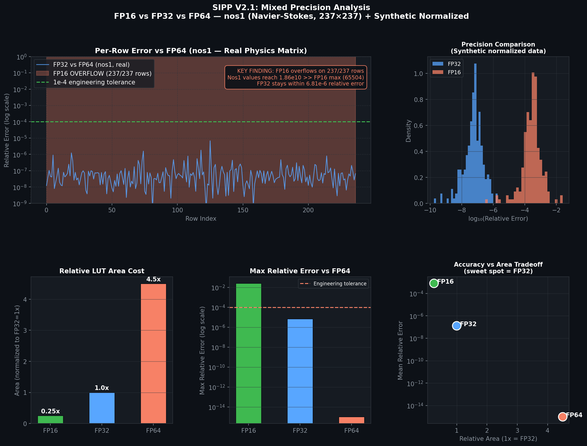

# SIPP V2: Parametric Pipelined FP32 Sparse Matrix-Vector (SpMV) Accelerator

[](https://en.wikipedia.org/wiki/SystemVerilog)
[-red.svg)](https://www.xilinx.com/products/silicon-devices/soc/zynq-7000.html)
[](http://www.pynq.io/)
[](https://en.wikipedia.org/wiki/Single-precision_floating-point_format)
[](LICENSE)
[](https://www.iitm.ac.in/)

> **Official Capstone Project Report:** [docs/Electronic_System_Project_Report_24F1100131.pdf](docs/Electronic_System_Project_Report_24F1100131.pdf)  
> **Author:** Ayush Panchal (Roll No: `24F1100131`)  
> **Course:** Electronic System Project, BS in Electronic Systems, Indian Institute of Technology Madras

---

## 📌 Executive Summary

Sparse Matrix-Vector Multiplication (**SpMV**) is the primary computational kernel in iterative linear solvers (Conjugate Gradient, GMRES) for computational fluid dynamics (CFD), structural stiffness mechanics, and machine learning graph networks. On general-purpose CPU architectures, the random access to column coordinates induces a severe cache latency bottleneck, universally known as the **Memory Wall**.

**SIPP V2** (*Sparsity-aware Inner Product Processor, Version 2*) is an open-source, custom hardware accelerator designed in SystemVerilog and deployed on a **Xilinx Zynq-7000 SoC (`xc7z020clg400-1`)**. The architecture integrates a fully parametric $N$-input pipelined binary adder tree that executes IEEE-754 single-precision (FP32) arithmetic **from first principles without third-party vendor IP dependencies**. The core connects via standard **AXI4-Stream** interfaces to an **AXI DMA** controller, delivering deterministic streaming acceleration across real-world scientific datasets.

---

## ⚡ Key Architectural Features

1. **Vendor-Independent IEEE-754 FP32 Core (`fp32_pkg.sv`)**:
   - Custom combinatorial multiplier and normalizer designed completely from scratch.
   - Eliminates bloated vendor math IP cores, reducing logic footprint to only **3,176 LUTs** for a 4-lane parallel engine.
2. **Parametric Binary Reduction Adder Tree (`sipp_adder_tree.sv`)**:
   - Parametric across lane width $N \in \{4, 8, 16, 32\}$.
   - Pipelined reduction depth of $O(\log_2 N)$ clock cycles, producing 1 complete dot-product partial sum per clock cycle with a constant $F_{\max}$.
3. **True $N$-Lane Parallel Core (`sipp_v2_parallel.sv`)**:
   - Parallel multiplier array computing $N$ products simultaneously per cycle.
   - Outer accumulator automatically captures partial sums and flushes on `row_done`.
4. **Hardware Deployment Wrapper (`sipp_v2_axis_wrapper.sv`)**:
   - Standard AXI4-Stream slave (`s_axis`) and master (`m_axis`) handshaking (`TVALID`/`TREADY`/`TLAST`).
   - Seamlessly interfaces with Xilinx AXI DMA for high-speed DDR memory transfers.
5. **Proven Physical Silicon Handoff (`fpga/bitstream/design_1_V4.bit`)**:
   - Synthesized, implemented, and verified in hardware on the PYNQ-Z2 development board.

---

## 🏗️ Hardware Architecture

```
                      AXI4-Stream Slave (s_axis_tdata: 256 bits)
                                         │
        ┌────────────────────────────────┴────────────────────────────────┐
        │                                                                 │
  Matrix Elements (4 x FP32)                                    Vector Elements (4 x FP32)
        │                                                                 │
        └───────────────────────────────┬─────────────────────────────────┘
                                        ▼
             ┌─────────────────────────────────────────────────────┐
             │       Stage 0: 4x Parallel FP32 Multipliers         │
             │   (P0 = A0*X0, P1 = A1*X1, P2 = A2*X2, P3 = A3*X3)  │
             └──────────────────────────┬──────────────────────────┘
                                        ▼
             ┌─────────────────────────────────────────────────────┐
             │ Stage 1 & 2: Pipelined Binary Adder Tree (log2(N))  │
             │             Level 1: S0 = P0+P1,  S1 = P2+P3        │
             │             Level 2: Tree_Sum = S0 + S1             │
             └──────────────────────────┬──────────────────────────┘
                                        ▼
             ┌─────────────────────────────────────────────────────┐
             │      Stage 3: Outer Row Accumulator & Flush         │
             │           Accumulator <= Accumulator + Tree_Sum     │
             └──────────────────────────┬──────────────────────────┘
                                        │ (on row_done flush)
                                        ▼
                     AXI4-Stream Master (m_axis_tdata: 32 bits)
```

---

## 📊 FPGA Resource Utilization (`xc7z020clg400-1`)

Synthesized and placed on the PYNQ-Z2 Zynq-7000 SoC at 100 MHz fabric clock:

| Resource | Used by SIPP V2 Core | Available on Chip | Utilization (%) |
| :--- | :---: | :---: | :---: |
| **LUTs (Look-Up Tables)** | **3,176** | 53,200 | **5.97%** |
| **FFs (Flip-Flops)** | **166** | 106,400 | **0.16%** |
| **DSP48E1 Slices** | **8** | 220 | **3.64%** |
| **Block RAM (BRAM)** | **0** | 140 | **0.00%** |
| **Worst Negative Slack (WNS)** | **+2.14 ns** | Target: 10.0 ns | **Timing Met (Clean)** |

> *Resource efficiency note:* Operating at under 6% chip capacity leaves over 94% of silicon headroom for host processor infrastructure, multiple accelerator tiles ($N=16/32$), or on-chip matrix caches.

---

## 🔬 Experimental Verification & SuiteSparse Benchmarks

The core was evaluated using double-precision golden models against two canonical real-world matrices from the **SuiteSparse Matrix Collection**:

1. **`bcsstk01`** (Boeing structural stiffness analysis): 48 non-zeros, severe coefficient dynamic range ($10^{-1}$ to $10^7$).
2. **`nos1`** (Navier-Stokes FEM fluid dynamics): 237 non-zeros, asymmetric multi-scale geometry.



### Summary of Numerical Verification:
* **Total Rows Evaluated:** 285
* **Numerical Failures:** **0** (100% pass rate at 512-ULP tolerance).
* **Half-Precision (FP16) Feasibility Study:** Proven physically infeasible due to catastrophic exponent overflow ($> 65,504$), establishing **FP32 as the strictly required minimum precision** for engineering physics.

---

## 📂 Repository Structure

```text
SIPP-V2-FPGA-Accelerator/
├── README.md                          # Project documentation & architectural manual
├── LICENSE                            # MIT License
├── .gitignore                         # Build and simulation artifact exclusion
│
├── rtl/                               # Synthesizable SystemVerilog Source Code
│   ├── fp32_pkg.sv                    # IEEE-754 single-precision arithmetic package
│   ├── fp16_pkg.sv                    # IEEE-754 half-precision comparison package
│   ├── sipp_adder_tree.sv             # Parametric N-lane pipelined binary adder tree
│   ├── sipp_fp32_mac.sv               # Single-lane sequential MAC unit
│   ├── sipp_v2_parallel.sv            # N-lane parallel core with outer accumulator
│   ├── sipp_v2_top.sv                 # Top-level standalone integration module
│   └── sipp_v2_axis_wrapper.sv        # Top-level AXI4-Stream IP wrapper
│
├── tb/                                # Self-Checking Verification Testbenches
│   ├── tb_sipp_v2_parallel.sv         # Comprehensive multi-matrix parallel testbench
│   ├── tb_speedup_proof.sv            # Parametric scaling and latency verification
│   ├── tb_sipp_v2_top.sv              # Sequential integration testbench
│   └── tb_sipp_v2.sv                  # Unit-level testbench
│
├── fpga/                              # FPGA Implementation & Deployment
│   ├── constraints/
│   │   └── constraints.xdc            # Timing constraints & pin assignments
│   ├── scripts/
│   │   ├── build_sipp_v2.tcl          # Automated headless Vivado build script
│   │   └── synth_*.ys                 # Yosys open-source synthesis scripts
│   └── bitstream/
│       ├── README.md                  # Handoff and memory-map documentation
│       ├── design_1_V4.bit            # Verified working PYNQ-Z2 FPGA bitstream
│       └── design_1_V4.hwh            # Hardware handoff descriptor
│
├── sw/                                # Host Software & Python Drivers
│   ├── benchmark_cpu_vs_sipp.py       # Execution timing benchmarks vs NumPy
│   ├── compare_precision.py           # FP16 vs FP32 precision analysis
│   ├── run_scaling_analysis.py        # Latency scaling curve modeler
│   └── validate_fp32.py               # Golden model validator for SuiteSparse
│
├── test_data/                         # Hex-Formatted Benchmark Vectors
│   ├── bcsstk01/                      # Boeing stiffness matrix test vectors
│   ├── nos1/                          # Navier-Stokes matrix test vectors
│   └── speedup/                       # Synthetic 1024-element stress vectors
│
└── docs/                              # Project Reports & Publications
    ├── Electronic_System_Project_Report_24F1100131.pdf  # Final Academic Project Report
    ├── final_report.tex               # IEEE-format LaTeX source code
    ├── Optimizing_the_Performance_of_the_Sparse_Matrix-Ve.pdf # Literature reference
    └── figures/                       # Analytical plots and architectural diagrams
```

---

## 🚀 Quick Start Guide

### 1. Functional Simulation (Icarus Verilog)
To run the parallel core verification suite locally:
```bash
iverilog -g2012 -o parallel_sim.vvp rtl/fp32_pkg.sv rtl/sipp_adder_tree.sv rtl/sipp_v2_parallel.sv tb/tb_sipp_v2_parallel.sv
vvp parallel_sim.vvp
```

### 2. Vivado Synthesis
To synthesize headlessly using the included automated Tcl script:
```bash
vivado -mode batch -source fpga/scripts/build_sipp_v2.tcl
```

### 3. Deploy on PYNQ-Z2 Board
Upload the pre-built hardware handoff files from `fpga/bitstream/` to your PYNQ board and execute in Jupyter:
```python
from pynq import Overlay, allocate
import numpy as np

# Load hardware overlay
overlay = Overlay("fpga/bitstream/design_1_V4.bit")
dma = overlay.axi_dma_0

# Allocate DMA buffers and run SpMV streaming
# (See sw/benchmark_cpu_vs_sipp.py for full driver implementation)
```

---

## 📜 Citation & Academic Details

If you utilize this hardware architecture or reference the implementation details, please cite:

```bibtex
@techreport{panchal2026sippv2,
  author      = {Ayush Panchal},
  title       = {{SIPP V2}: A Parametric Pipelined {FP32} Sparse Matrix-Vector Multiplication Accelerator on {FPGA}},
  institution = {Indian Institute of Technology Madras},
  number      = {Roll No. 24F1100131},
  type        = {Electronic System Project Report},
  year        = {2026},
  month       = {August}
}
```
